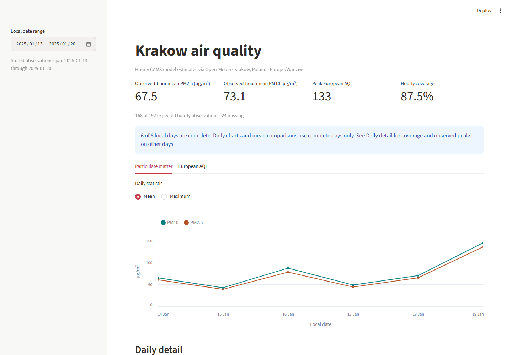

# Krakow Air Quality Intelligence

Explore hourly modeled PM2.5, PM10 and European AQI for Krakow. The pipeline loads completed UTC days into PostgreSQL. The Streamlit dashboard compares daily means, pollution peaks and coverage by local calendar date.

## Run with Docker Compose

Install Docker with the Compose v2 plugin and start the Docker engine. Extract the ZIP if needed and open a terminal in the folder containing `compose.yaml`. You need internet access to download images and retrieve data from Open-Meteo.

Set a local database password. In PowerShell, the following command generates a new value for the current session. Save the value securely and reuse it with the same database volume.

```powershell
$env:POSTGRES_PASSWORD = [guid]::NewGuid().ToString("N")
```

Alternatively, create an untracked local `.env` file beside `compose.yaml` and add `POSTGRES_PASSWORD=<your-generated-password>`, replacing the entire placeholder. Compose reads this file automatically. Then run:

```sh
docker compose build
docker compose run --rm etl --date 2025-01-15
docker compose up -d dashboard
```

Open the [dashboard](http://localhost:8501). Repeat the ETL command with other dates to extend the report. Refresh the dashboard after loading more data. Use `docker compose down` to stop the services.

The database starts automatically and uses a named volume. A successful import logs the number of validated and changed hours. An identical repeat reports zero changes. Omit `--date` to load yesterday in UTC.

## Run with Python

Use Python 3.12 or later in a virtual environment. The preview command prints the validated response without opening a database connection.

```sh
python -m pip install -e ".[test]"
python -m krakow_air --date 2025-01-15 --preview
python -m pytest -q
```

To run the full application locally, configure an existing PostgreSQL database as described below, then run these commands from the project root:

```sh
python -m krakow_air --date 2025-01-15
python -m streamlit run krakow_air/dashboard.py
```

For local ingestion, set the `DATABASE_URL` environment variable in your shell to `postgresql+psycopg://<user>:<url-encoded-password>@<host>:5432/<database>`. The role needs permission to create and write the table. The dashboard reads the same connection setting and requires SELECT access to the table. For integration tests, set `TEST_DATABASE_URL` using the same dialect and a disposable database where the test role can create schemas. The tests create and remove uniquely named schemas. Without this variable pytest skips the PostgreSQL integration tests. The GitHub Actions workflow is configured to provision PostgreSQL 16 and run the suite against it.

## Architecture and decisions

1. **Extract.** A CLI invocation requests one completed UTC day from the Open-Meteo Air Quality API. Requests have a timeout and up to three attempts on transient network errors and selected HTTP status codes.
2. **Validate.** The transformer requires exactly 24 consecutive hourly timestamps, matching units, and finite, nonnegative values for all three metrics. A malformed or incomplete day fails before any write. No missing values are imputed.
3. **Load.** SQLAlchemy submits one PostgreSQL transaction. The UTC model-valid timestamp is the primary key for this single location and domain. The loader inserts new hours and updates revised values. Identical values leave the row and its update timestamp untouched. A transaction-scoped advisory lock guards concurrent bootstrap and writes.
4. **Analyze and display.** The dashboard queries PostgreSQL through SQLAlchemy. The [daily report SQL](krakow_air/sql/daily.sql) generates expected hourly slots between the two local midnights bracketing the inclusive date selection. A left join keeps empty days visible. PostgreSQL performs aggregation and window calculations. Pandas shapes the daily results for Streamlit and Altair.
5. **Verify.** Offline contract tests use explicitly synthetic inputs. PostgreSQL integration coverage checks replay, source revisions, and transaction rollback. Live API availability is outside the CI test contract.

## Reading the dashboard

- **Particulate matter.** Switch between daily means and maximum hourly concentrations. The summary means weight each observed hour equally across the selected dates.
- **European AQI.** Compare the daily mean with the worst observed hourly index. The mean summarizes the model's hourly index values and is not a separate official daily index.
- **Changes.** The detail table shows the difference from the previous calendar day's mean within the filter. Changes require two consecutive complete local days. Other deltas are left blank.
- **Coverage.** Daily and overall coverage divide observed hours by expected hours. In Europe/Warsaw, a spring clock change yields 23 hours and an autumn change yields 25. Daily charts use complete days only. The detail table labels each day as Complete, Partial or Missing and leaves daily means blank for incomplete days. Observed peaks remain visible in the table and can underestimate a partial day's true maximum. Days with no observations retain empty pollution values.
- **Interaction.** Choose an inclusive range in the sidebar, hover over chart points for exact values and zoom or pan along the time axis. The initial range ends at the last stored local date.



The screenshot uses real Open-Meteo responses loaded for January 13-19, 2025 UTC. In Krakow the first record is January 13 at 01:00 and the last is January 20 at 00:00. The local days contain 23 hours, six full days of 24 hours, and one final hour. Selecting all eight local dates gives 168 of 192 expected hours (87.5%). All 168 hours of the requested UTC interval are present. To reproduce the screenshot, run this PowerShell loop from the project root after the Compose setup above:

```powershell
foreach ($day in 13..19) {
    docker compose run --rm etl --date "2025-01-$day"
    if ($LASTEXITCODE -ne 0) { throw "Import failed for January $day" }
}
docker compose up -d dashboard
```

Refresh the dashboard and select January 13 through January 20, 2025 in the local date filter. Six complete local days contribute to the charts. The two boundary dates remain visible in Daily detail. Later source revisions may change pollutant values.

## Data provenance and limitations

The request uses coordinates 50.0647° N, 19.9450° E and explicitly selects the CAMS European domain. PM2.5 and PM10 are hourly concentrations in μg/m³. European AQI is the provider's dimensionless index. Data are provided by the Copernicus Atmosphere Monitoring Service (CAMS) through Open-Meteo. [Open-Meteo Air Quality API and source attribution](https://open-meteo.com/en/docs/air-quality-api)

These are gridded model estimates, not direct station measurements. A city-centre grid cell cannot resolve street-level variation. The table retains the latest retrieved values per valid hour, so it cannot reconstruct past model vintages. UTC days can cross local calendar-day boundaries. A completed UTC import can therefore leave partial local days at either end of a report. A rejected day requires a later retry by the operator.
